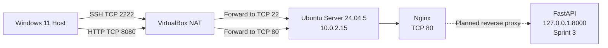

# Sprint 2 Report: Networking and Security

| Field | Value |
|---|---|
| Sprint | 2 |
| Period | 2026-11-28 |
| Status | Networking, SSH security, firewall configuration, and Nginx tests completed; documentation and repository review pending |
| Author | Ekin |
| Environment | Ubuntu Server 24.04.5 LTS in VirtualBox 7.2.22 on Windows 11; VM `linuxops-server`; NAT network |

## 1. Overview

Sprint 2 focused on network connectivity, secure remote access, firewall configuration, and basic web server deployment.

The work included configuring SSH key-based authentication, applying UFW firewall rules, testing allowed and blocked ports, installing Nginx, and verifying HTTP access from both the Ubuntu virtual machine and the Windows host.

The virtual machine uses VirtualBox NAT networking. Host port forwarding provides access to selected guest services without using bridged networking.

## 2. Learning Objectives

The following topics were covered through practical exercises:

- Understanding IP addresses and DNS resolution
- Understanding TCP and UDP
- Distinguishing localhost from a virtual machine IP address
- Comparing NAT and bridged networking
- Configuring SSH public-key authentication
- Managing incoming traffic with UFW
- Inspecting listening ports and network services
- Installing and managing Nginx
- Testing HTTP connectivity from the guest and host systems
- Verifying that unapproved incoming traffic is blocked

## 3. Concepts and Explanations

**IP addresses and DNS**

An IP address identifies a network interface or endpoint so that network traffic can reach it. DNS translates human-readable domain names into IP addresses.

For example, `getent hosts google.com` was used to verify that the Ubuntu system could resolve a domain name.

**TCP and UDP**

TCP provides a connection-oriented, reliable, ordered stream of data. SSH and HTTP communication in this project use TCP.

UDP sends independent datagrams without providing TCP-style delivery or ordering guarantees. It is commonly used by services such as DNS and DHCP.

**Localhost and VM IP address**

The address `127.0.0.1` refers to the loopback interface of the machine where the command is executed.

Windows `127.0.0.1` and Ubuntu `127.0.0.1` refer to different systems. The Ubuntu VM uses `10.0.2.15` on its NAT network interface.

**NAT and bridged networking**

With NAT networking, the virtual machine accesses external networks through VirtualBox network address translation. Incoming connections to guest services require port forwarding.

With bridged networking, the VM appears as a separate device on the physical local network and normally receives its own LAN address.

This project uses NAT networking.

**SSH public-key authentication**

SSH public-key authentication uses a private key kept by the client and a corresponding public key stored on the server. The private key must not be shared or committed to the repository.

The connection was tested with password authentication explicitly disabled, confirming that the key was sufficient.

**UFW firewall**

UFW provides a simple interface for managing Linux firewall rules. The incoming default policy was set to deny, while outgoing traffic was allowed.

SSH and HTTP were explicitly allowed. A separate test on TCP port 8081 confirmed that other incoming traffic was blocked.

**Nginx**

Nginx is a web server that listens for HTTP requests and can also act as a reverse proxy.

In this sprint, Nginx serves its default welcome page. Connecting it to the FastAPI application is planned for Sprint 3.

## 4. Commands Used

The following commands were used during practical work.

**Network inspection**

- `ip a` — inspect network interfaces and IP addresses
- `ip route` — inspect routing information
- `getent hosts google.com` — test DNS resolution
- `ping` — test network reachability
- `ss -tulpn` — inspect listening ports and processes

**SSH**

- `ssh` — connect to the Ubuntu server
- `ssh -o PreferredAuthentications=publickey -o PasswordAuthentication=no ...` — test key-only authentication

**Firewall**

- `sudo ufw allow 22/tcp` — allow SSH
- `sudo ufw allow 80/tcp` — allow HTTP
- `sudo ufw default deny incoming` — deny incoming traffic by default
- `sudo ufw default allow outgoing` — allow outgoing traffic
- `sudo ufw enable` — enable the firewall
- `sudo ufw status verbose` — inspect firewall configuration
- `sudo ufw status numbered` — list firewall rules
- `sudo journalctl -k` — inspect kernel firewall log messages

**Nginx and HTTP**

- `sudo apt update` — refresh package information
- `sudo apt install nginx -y` — install Nginx
- `sudo systemctl status nginx --no-pager` — inspect Nginx service status
- `sudo ss -tulpn | grep nginx` — inspect Nginx listening ports
- `curl -I http://127.0.0.1` — test HTTP locally on Ubuntu
- `curl.exe -I http://127.0.0.1:8080` — test HTTP from Windows

## 5. Network Architecture

The following diagram represents the network configuration used in this sprint.



VirtualBox port forwarding was configured as follows:

| Host port | Guest port | Protocol | Purpose |
|---|---:|---|---|
| 2222 | 22 | TCP | SSH access |
| 8080 | 80 | TCP | Nginx HTTP access |

The guest VM address on the NAT network was `10.0.2.15`.

## 6. Configuration Details

**SSH key authentication**

An Ed25519 SSH key pair was generated on Windows. The public key was added to the Ubuntu user's `~/.ssh/authorized_keys` file.

The following test completed successfully without password authentication:

```powershell
ssh -o PreferredAuthentications=publickey -o PasswordAuthentication=no ekin@127.0.0.1 -p 2222
```

A new SSH session was also tested after enabling UFW to verify that remote access remained available.

**UFW firewall configuration**

The firewall was enabled with the following policies:

- Default incoming policy: deny
- Default outgoing policy: allow
- Allowed incoming TCP ports: 22 and 80

The active rules included IPv4 and IPv6 entries for both ports.

**Nginx installation**

Nginx was installed using the Ubuntu package manager. The service was confirmed as active and enabled.

Nginx listened on TCP port 80 on IPv4 and IPv6 interfaces. The default Nginx welcome page was served successfully.

## 7. Expected vs. Actual Output

**SSH key authentication**

Expected: A connection should succeed when public-key authentication is enabled and password authentication is disabled.

Actual: The SSH connection succeeded without requesting the Ubuntu account password.

Evidence: `01-ssh-key-authentication.png`

**UFW allowed ports**

Expected: TCP ports 22 and 80 should be allowed for incoming traffic.

Actual: `sudo ufw status numbered` showed rules allowing both ports for IPv4 and IPv6.

Evidence: `02-ufw-firewall-rules.png`

**Nginx service**

Expected: Nginx should be active and enabled.

Actual: `systemctl status nginx` showed `Active: active (running)` and the service was enabled at boot.

Evidence: `03-nginx-service-status.png`

**Nginx listening port**

Expected: Nginx should listen on TCP port 80.

Actual: `ss -tulpn` showed Nginx listening on `0.0.0.0:80` and `[::]:80`.

Evidence: `04-nginx-listening-port.png`

**Local HTTP test**

Expected: An HTTP request to Ubuntu's localhost on port 80 should return a successful response.

Actual: `curl -I http://127.0.0.1` returned `HTTP/1.1 200 OK`.

Evidence: `05-nginx-local-http-test.png`

**Windows-to-Nginx HTTP test**

Expected: Windows should reach the guest Nginx service through the VirtualBox host port forwarding rule.

Actual: `curl.exe -I http://127.0.0.1:8080` returned `HTTP/1.1 200 OK`. The default Nginx welcome page was also opened in the Windows browser.

Evidence: `06-windows-to-nginx-http.png`

**Blocked incoming port test**

Expected: Incoming TCP traffic to port 8081 should be blocked because no UFW allow rule exists for that port.

Actual: A temporary test HTTP server was started on guest port 8081 and a temporary VirtualBox forwarding rule was created. The Windows connection did not succeed. Kernel logs contained `[UFW BLOCK]` entries for destination port 8081.

The temporary forwarding rule was removed after the test. No UFW allow rule was added for port 8081.

Evidence: `07-ufw-blocked-port-8081.png`

## 8. Troubleshooting Notes

- An SSH connection attempt made from inside Ubuntu to `127.0.0.1:2222` failed because that address refers to the Ubuntu guest itself, not the Windows host forwarding port. The connection succeeded when tested from Windows.
- VirtualBox `modifyvm` could not be used to change NAT forwarding while the VM was running. The active VM configuration was updated using `controlvm`.
- The temporary port 8081 test demonstrated the UFW default-deny incoming policy. The temporary forwarding rule was removed after verification.
- The Windows host reached Nginx through port 8080, which VirtualBox forwarded to guest port 80.

## 9. Screenshots and Evidence

All Sprint 2 screenshots are stored in `evidence/sprint-02/`.

| File | Evidence |
|---|---|
| `01-ssh-key-authentication.png` | SSH key-only authentication |
| `02-ufw-firewall-rules.png` | UFW firewall rules |
| `03-nginx-service-status.png` | Nginx service status |
| `04-nginx-listening-port.png` | Nginx listening on port 80 |
| `05-nginx-local-http-test.png` | Local HTTP response |
| `06-windows-to-nginx-http.png` | HTTP access from Windows |
| `07-ufw-blocked-port-8081.png` | Blocked port test and firewall evidence |

## 10. Deliverables Checklist

- [x] SSH public-key authentication configured and tested
- [x] UFW enabled with default-deny incoming policy
- [x] SSH and HTTP firewall rules configured
- [x] Listening ports inspected
- [x] Nginx installed and running
- [x] Local HTTP test completed
- [x] Windows-to-VM HTTP test completed
- [x] Blocked incoming port test completed
- [x] Screenshots collected in the Sprint 2 evidence directory
- [ ] Sprint report reviewed and committed to Git

## 11. Outstanding Work and Next Steps

The following tasks are planned for Sprint 3:

- Deploy the FastAPI application on Ubuntu
- Run the application as a dedicated non-root service account
- Bind FastAPI to `127.0.0.1:8000`
- Configure Nginx as a reverse proxy to FastAPI
- Create a systemd service for application startup and supervision
- Verify service logs and application availability

The current Nginx configuration serves the default welcome page. FastAPI reverse proxy integration has not yet been completed.

## 12. Sprint Conclusion

Sprint 2 established secure SSH access, configured the UFW firewall, verified allowed and blocked incoming traffic, and deployed a working Nginx web server.

Both local and Windows-to-VM HTTP connectivity tests returned successful responses. The environment is ready for the application deployment and reverse proxy work planned for Sprint 3.
